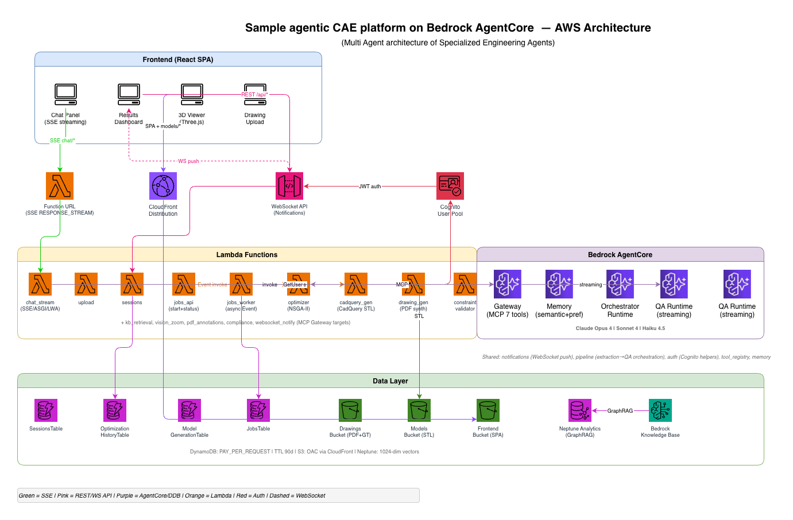

# Agentic CAE Platform — Amazon Bedrock AgentCore Sample

An end-to-end **Computer-Aided Engineering (CAE)** platform powered by [Amazon Bedrock AgentCore](https://aws.amazon.com/bedrock/agentcore/). A pit crew of specialized AI agents collaborates to transform static engineering drawings into actionable engineering intelligence — from structured data extraction through design optimization to interactive 3D visualization.

## What This Application Does

Engineers upload engineering drawings (PDF) and the platform autonomously:

1. **Extracts** structured metadata (dimensions, tolerances, materials, GD&T callouts) using vision AI (Claude Sonnet 4) into a standardized Ground Truth JSON schema.
2. **Answers questions** about drawings in natural language via a streaming QA agent backed by GraphRAG retrieval (Neptune Analytics + Bedrock Knowledge Base).
3. **Optimizes designs** by feeding extracted specifications as constraints into multi-objective optimization (NSGA-II + Bar-Cohen thermal physics models), producing Pareto-optimal design alternatives.
4. **Generates 3D models** parametrically from optimization results using CadQuery, exportable as STL for CAD/CAM workflows.
5. **Visualizes results** in an interactive React frontend with Three.js 3D rendering, Recharts Pareto plots, and real-time streaming chat.

All capabilities are orchestrated by an **Orchestrator agent** (Claude Opus 4) that routes user intent to the appropriate specialized agent, with cross-session context maintained via AgentCore Memory.

## Architecture



The platform deploys as a **single AWS CDK stack** using serverless services:

### Frontend Tier
- **React SPA** (Vite, TailwindCSS, Three.js) served via **CloudFront** from S3
- Token-by-token chat streaming over **SSE** (Lambda Function URL + AWS Lambda Web Adapter)
- Async operations (optimization, 3D generation) via REST polling pattern

### API Layer
- **HTTP API Gateway** — upload, sessions, jobs endpoints with Cognito JWT authorizer
- **WebSocket API Gateway** — real-time bidirectional communication with Lambda REQUEST authorizer
- **Amazon Cognito** — user authentication (email/password, SRP, 60-min access tokens)

### Compute Layer (14 Lambda Functions)
- `upload` — presigned URL generation + extraction trigger
- `sessions` — optimization history and session management
- `chat_stream` — SSE container (Starlette/uvicorn + LWA)
- `jobs_api` + `jobs_worker` — async job dispatch and execution
- 4 WebSocket handlers (connect, disconnect, message, authorizer)
- 7 MCP tool targets (retrieve, zoom_and_read, annotations, compliance, optimize, generate_3d, validate_constraints)

### Amazon Bedrock AgentCore
- **Gateway** — MCP protocol with semantic tool discovery across 7 targets
- **Memory** — semantic + user-preference strategies for cross-session context (90-day TTL)
- **4 Runtimes** (containerized, HTTP protocol):
  - *Orchestrator* — Claude Opus 4, intent routing to specialized agents
  - *QA* — Claude Sonnet 4, streaming responses with GraphRAG retrieval
  - *Extraction* — Claude Sonnet 4 (vision) + Haiku 4.5 for entity extraction
  - *Optimizer* — NSGA-II multi-objective optimization with physics models
- **Identity** — Workload Identity + OAuth2 credential provider

### Data Layer
- **3 DynamoDB tables** — Sessions, Connections, OptimizationHistory (PAY_PER_REQUEST, TTL 90 days)
- **3 S3 buckets** — Drawings (PDF + Ground Truth JSON), Models (STL), Frontend (SPA)
- **Neptune Analytics** — 1024-dimension vector index for GraphRAG
- **Bedrock Knowledge Base** — FM Parser + chunk entity extraction over the drawings corpus

### Key Design Decisions
- **Single CDK stack** — one `cdk deploy` provisions everything; `cdk destroy` tears down cleanly
- **Least-privilege IAM** — every policy scoped to concrete ARNs; no bare `*` resource wildcards
- **No VPC required** — all services use public endpoints with IAM/Cognito auth
- **Multi-agent collaboration** — the Orchestrator delegates to specialized agents rather than one monolithic LLM call, improving accuracy and enabling independent scaling

## Repository Structure

```
infra/     CDK (TypeScript) — the single stack deploying all AWS resources
agents/    Python agent runtimes (Strands Agents SDK + Bedrock AgentCore Runtime)
tools/     Python Lambda tool targets registered with the AgentCore Gateway
frontend/  React + TypeScript SPA (Vite, TailwindCSS, Recharts, Three.js)
shared/    JSON Schema definitions and validators (Python + TypeScript)
tests/     Python unit and property-based tests (pytest + Hypothesis)
```

Each top-level directory has its own `README.md` with more detail.

## Prerequisites

- Node.js 20+ and npm
- Python 3.13+
- AWS CLI configured with credentials for the target account
- AWS CDK CLI (`npm install -g aws-cdk` or use `npx cdk` from `infra/`)
- Docker (for container-based Lambda functions)
- Bedrock model access enabled for: Claude Opus 4, Claude Sonnet 4, Claude Haiku 4.5, Amazon Titan Embeddings v2

## Getting Started

### 1. Clone the repository

```bash
git clone https://github.com/aws-samples/sample-agentic-cae-platform-bedrock-agentcore.git
cd sample-agentic-cae-platform-bedrock-agentcore
```

### 2. Node workspaces (infra + frontend)

This repo uses npm workspaces to manage the TypeScript projects from the root:

```bash
npm install          # installs infra/ and frontend/ dependencies
npm run build        # builds all workspaces
npm run test         # runs tests in all workspaces
```

You can also work within each project directly:

```bash
cd infra && npm install && npx cdk synth
cd frontend && npm install && npm run dev
```

### 3. Python packages (agents, tools, shared, tests)

Python dependencies are declared in the root `pyproject.toml`. From the repository root:

```bash
python3 -m venv .venv
source .venv/bin/activate
pip install -e ".[agents,tools,dev]"
pytest
```

### 4. Deploy the stack

```bash
cd infra
npx cdk bootstrap   # first-time only
npx cdk deploy -c environment=dev
```

After deployment, CDK outputs will be written to `infra/cdk-outputs.json`. Copy the relevant values to `frontend/.env.production` (see `infra/cdk-outputs.example.json` for the expected structure).

### 5. Configure the frontend

```bash
cd frontend
cp .env.example .env.local
# Fill in values from CDK stack outputs
npm run dev
```

### 6. Clean up

```bash
cd infra
npx cdk destroy -c environment=dev
```

All resources (tables, buckets, graphs) are configured with `RemovalPolicy.DESTROY` and `autoDeleteObjects` so teardown is complete.

## Authors

- **Ayush Ragesh**
- **Sangram Sonawane**
- **Yogendra Singh**
- **Yogish Kutkunje Pai**

## Security

See [CONTRIBUTING](CONTRIBUTING.md#security-issue-notifications) for more information.

## License

This library is licensed under the MIT-0 License. See the [LICENSE](LICENSE) file.
